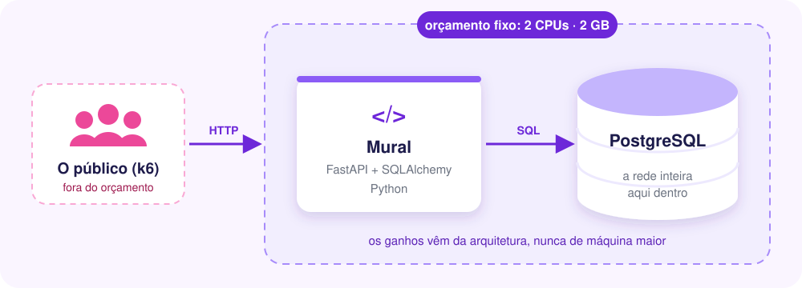
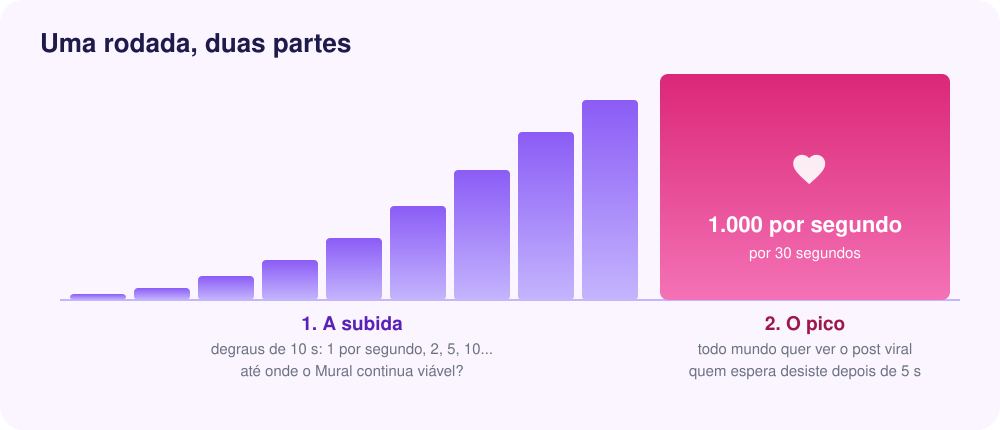
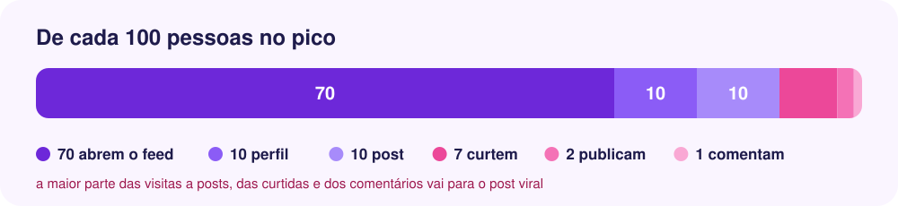

<p align="center">
  
</p>

<p align="center">
  
  
  
  
  
  
</p>

<p align="center">
  <b>Seguir, publicar, curtir, comentar. Parece simples.</b><br>
  Até a maior celebridade da rede publicar um post que todo mundo quer ver.
</p>

<p align="center">
  <a href="#-comece-em-1-minuto">Comece agora</a> ·
  <a href="#-as-aulas">As aulas</a> ·
  <a href="#-o-dia-em-que-um-post-viralizou">O teste de carga</a> ·
  <a href="#-as-regras-do-jogo">As regras do jogo</a>
</p>

---

## 💜 Por que uma rede social?

Porque poucas aplicações maltratam tanto um banco de dados. Para montar **um único feed**, o
banco precisa cruzar quem eu sigo com **1 milhão de posts**, ordenar do mais novo para o mais
antigo, paginar e contar as curtidas de cada um. E a rede não é igual para todo mundo:

<p align="center">
  
</p>

O Mural é essa rede social, rodando na sua máquina com uma rede inteira no banco. A cada aula
ele enfrenta **um problema de banco de dados** que aparece quando a carga cresce, e a gente
mede, com números, o que muda.

## 🚀 Comece em 1 minuto

Você só precisa do **Docker**. A partir da raiz do repositório:

```bash
cd mural/01-monolito

docker compose up -d --build --wait                                # sobe o Mural (a 1ª vez cria a rede inteira)
docker compose run --rm --service-ports k6 run /scripts/viral.js   # o dia em que um post viralizou
```

Enquanto o teste roda, abra o painel ao vivo em **http://localhost:5665**. No fim, o
relatório completo fica em **`relatorios/viral.html`**.

<details>
<summary><b>Outros comandos úteis</b></summary>

```bash
docker compose stats                          # CPU e memória de cada peça, ao vivo
docker compose exec postgres psql -U mural    # o banco, para olhar por dentro
docker compose down -v                        # derruba e apaga os dados
```

</details>

## 📚 As aulas

Cada etapa é uma pasta independente, com o código, o `docker-compose.yml` e um roteiro
para a aula (`DEMO.md`): o que rodar, onde olhar e as perguntas para a turma.

| Etapa | Tema |
|:-----:|------|
| [`01-monolito`](01-monolito/) | **O ponto de partida.** FastAPI síncrono, SQLAlchemy ORM do jeito mais direto, e Postgres. Quanto ele aguenta? |

> 🚧 **Em construção.** As próximas aulas vão atacar, uma de cada vez, os problemas que
> aparecem no banco quando o Mural cresce.

## 🧩 O que tem dentro

<p align="center">
  
</p>

| Rota | O que faz |
|------|-----------|
| `GET /feed?usuario_id=&pagina=` | os posts de quem o usuário segue, dos mais novos para os mais antigos, de 20 em 20 |
| `GET /usuarios/{id}` | o perfil: o usuário e os posts dele |
| `GET /posts/{id}` | o post com os comentários mais recentes |
| `POST /posts` | publica: `{"usuario_id": 42, "texto": "..."}` |
| `POST /posts/{id}/curtidas` | curte: `{"usuario_id": 42}` (201; se já tinha curtido, 200) |
| `POST /posts/{id}/comentarios` | comenta: `{"usuario_id": 42, "texto": "..."}` |

Sem login, para simplificar: quem escreve diz quem é no corpo da requisição.

### A rede inicial

Na primeira subida, o Mural cria uma rede inteira, direto no banco:

| 👥 Usuários | 🔗 "Segue" | 📝 Posts | ❤️ Curtidas | 💬 Comentários |
|:-----------:|:----------:|:--------:|:-----------:|:--------------:|
| 100 mil | ~5 milhões | 1 milhão | ~5 milhões | 500 mil |

Desigual como uma rede de verdade: cada um segue de 1 a 300 pessoas, poucas celebridades
concentram os seguidores, e poucos posts concentram as curtidas. Para mudar o tamanho:
`USUARIOS_INICIAIS`, `POSTS_INICIAIS`, `CURTIDAS_INICIAIS` e `COMENTARIOS_INICIAIS`
(veja o `docker-compose.yml`).

## 🔥 O dia em que um post viralizou

Um único teste de carga, [`shared/load-tests/viral.js`](shared/load-tests/viral.js), igual
em todas as aulas. A maior celebridade da rede publica um post, e todo mundo aparece.

<p align="center">
  
</p>

1. **A subida:** as requisições chegam em degraus de 15 segundos. Em cada degrau o teste
   confere se o Mural continua viável e descobre **quantas requisições por segundo ele aguenta**.
2. **O pico:** por 1 minuto chegam **1.000 requisições por segundo**. A maioria das pessoas fica
   na primeira página do feed, poucas rolam bem fundo, e quem rola pede uma página depois da
   outra. Quem espera desiste depois de 5 s.

<p align="center">
  
</p>

No fim, o relatório (`relatorios/viral.html`) mostra:

- 📈 **a capacidade:** até quantas requisições por segundo o Mural aguenta;
- 🪜 **a progressão:** degrau a degrau, quantas chegaram e quantas foram atendidas;
- ⏱️ **a velocidade de cada endpoint**, na subida e no pico;
- ❤️ **a conferência das curtidas do post viral:** quantas foram aceitas e quantas o Mural mostra;
- 🏁 **a comparação com as etapas anteriores**, lado a lado.

## 📏 As regras do jogo

- **O orçamento é fixo:** o Mural tem sempre **2 CPUs e 2 GB de RAM**, somando tudo o que é dele.
  Uma peça nova divide esse orçamento com as outras. O gerador de carga (k6) fica de fora.
- **Os ganhos vêm da arquitetura**, nunca de máquina maior.
- **Toda aula se mede com o mesmo teste**, e o relatório compara com as etapas anteriores.

<p align="center">
  <sub>Parte do <a href="../">Mini Curso de System Design para Aplicações Web</a> · feito para quem está começando 💜</sub>
</p>
